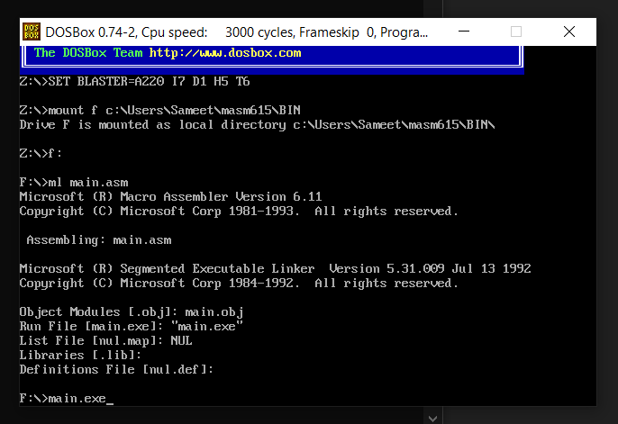
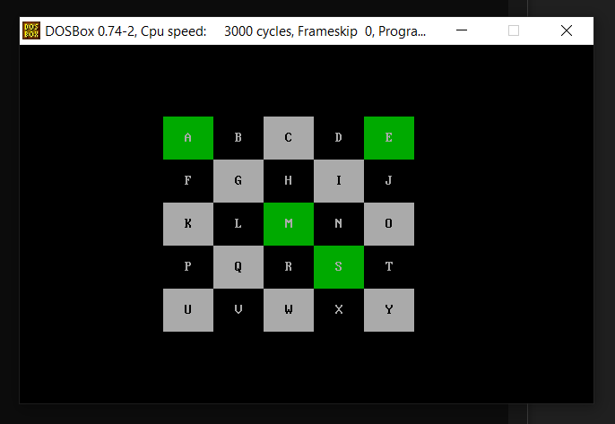
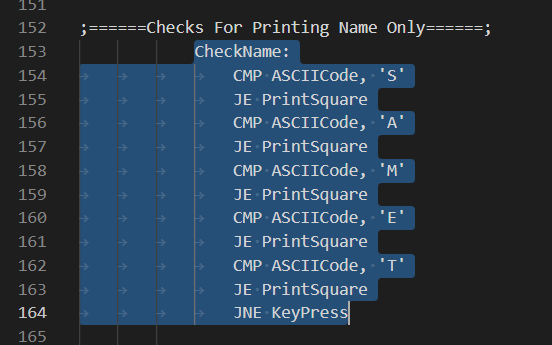
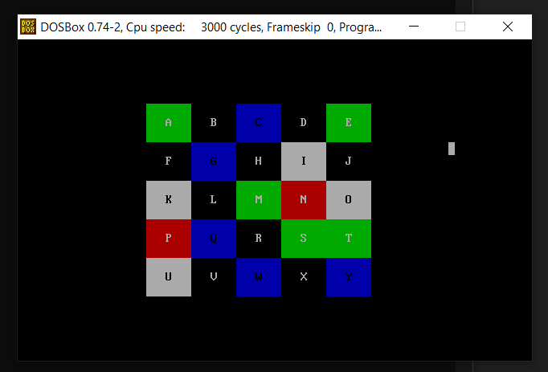

<h1 align="center">Checker Board in Assembly</h1>

### Description
It is a 5x5 `Interactive Checker Board` coded in `Assembly Language`. Interctive means that it gives response to your `Keyboard and Mouse Inputs`. You must first give keyboard inputs and then mouse inputs for it to work. For keyboard input, you must type your name in all capital letters and squares with those alphabets on the checker board will turn green. For mouse input, you can click on any alphabet as you want and their color will change. On clicking, black square will turn red and white square will turn blue.

### Manual
1) Use these command in dosbox to `Compile` and `Run` the code:
    ```
    ml main.asm
    ```
    ```
    main.exe
    ```
    
    <div align="center">
      
    </div>

2) For `Keyboard Input`, press `CapsLock` and then `Type Your Name`. You will see those squares turning into green:
    <div align="center">
      
    </div>
    
3) To change the code and make it `Work for Your Name`, you must replace the alphabets of my name with yours here:
    <div align="center">
      
    </div>
    
4) For `Mouse Input`, click on any square you want. Black squares will turn red and white squares will turn blue:
    <div align="center">
      
    </div>
