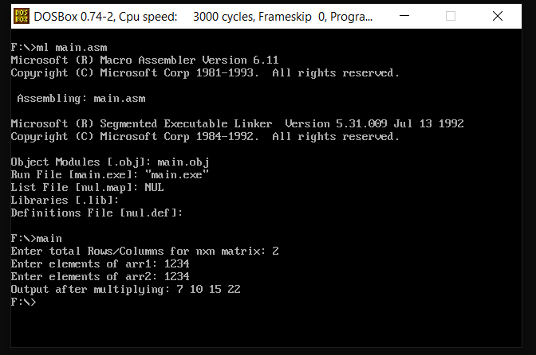

<h1 align="center">Matrix Multiplication in Assembly</h1>

### Description
An 8086 assembly implementation for multiplying two N×N matrices.

### Manual
1) Use these command in dosbox to `Compile` and `Run` the code. First input the `Size` of N, then enter elements of matrices `Without any Space in Row-Major Order`:
    ```
    ml main.asm
    ```
    ```
    main.exe
    ```
    
    <div align="center">
      
    </div>
