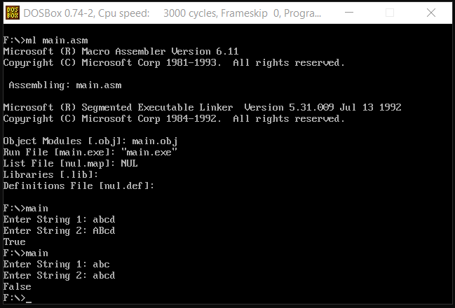

<h1 align="center">String Matching in Assembly</h1>

### Description
An 8086 assembly string comparison that matches character sequences without case sensitivity.

### Manual
1) Use these command in dosbox to `Compile` and `Run` the code:
    ```
    ml main.asm
    ```
    ```
    main.exe
    ```
    
    <div align="center">
      
    </div>
