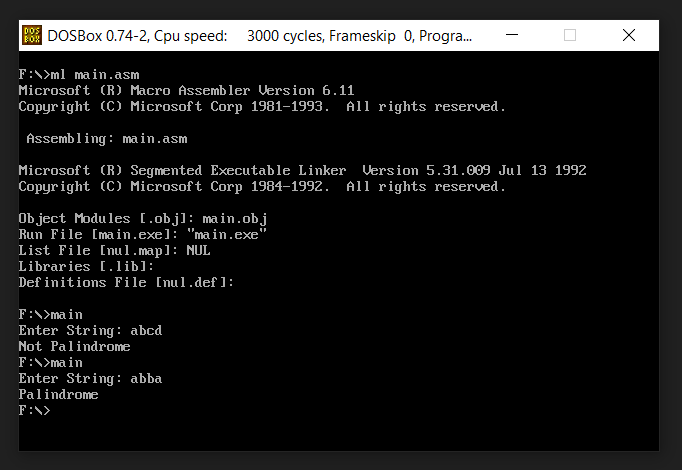

<h1 align="center">Check Palindrome in Assembly</h1>

### Description
An 8086 assembly string routine that detects whether an input is a palindrome.

### Manual
1) Use these command in dosbox to `Compile` and `Run` the code. Give the string as input to check whether it is palindrome or not:
    ```
    ml main.asm
    ```
    ```
    main.exe
    ```
    
    <div align="center">
      
    </div>
