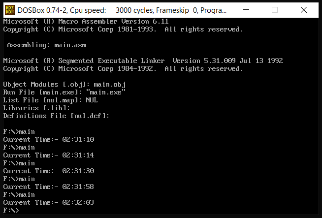

<h1 align="center">Get Current Time in Assembly</h1>

### Description
A DOS x86 assembly utility that reads and displays the current system time through DOS services.

### Manual
1) Use these command in dosbox to `Compile` and `Run` the code:
    ```
    ml main.asm
    ```
    ```
    main.exe
    ```
    
    <div align="center">
      
    </div>
